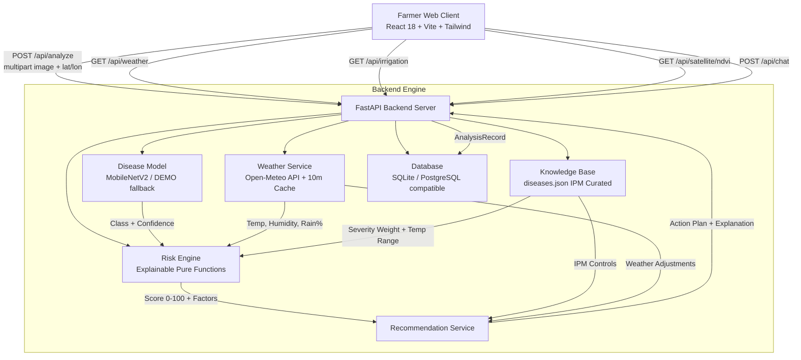

# FarmAI - AI-Powered Sustainable Farming Decision-Support System

> **Positioning:** An AI-powered agricultural decision-support system that combines crop-image analysis, local weather intelligence, satellite vegetation monitoring, and agricultural knowledge to deliver explainable, sustainable recommendations to farmers.

---

## 1. System Architecture



---

## 2. Key Features

- **Leaf Disease Classification**: MobileNetV2 transfer learning (224×224 input) detecting 14 agricultural conditions across Tomato, Potato, and Bell Pepper with deterministic DEMO fallback.
- **Explainable Multi-Factor Risk Engine**: Calculates a transparent 0–100 score and categorical level (`LOW`, `MEDIUM`, `HIGH`, `UNCERTAIN`) breaking down individual points for:
  - Disease Detection (0–45 pts)
  - Relative Humidity (0–20 pts)
  - Rain Probability (0–15 pts)
  - Pathogen Temperature Favourability (0–10 pts)
  - Leaf-Wetness Proxy (0–10 pts)
  - Optional Satellite Field Stress (0–15 pts)
- **Live Local Weather Intelligence**: Real-time temperature, humidity, precipitation probability, and 3-day forecast from Open-Meteo with in-memory caching and zero-crash fallback.
- **Safety-First IPM Advisory**: Curated recommendations strictly ordered by Integrated Pest Management (IPM) hierarchy:
  1. Scouting & Monitoring
  2. Cultural Sanitation
  3. Water & Irrigation Management
  4. Biological Antagonists
  5. Chemical Advisory (last resort, generic ingredients only, zero brand names or dosages, always accompanied by the mandatory Krishi Vigyan Kendra confirmation notice).
- **Satellite Vegetation (NDVI) Monitoring**: Sentinel-2 L2A STAC integration with raster calculation and synthetic noise fallback.
- **Farmer-Friendly UI**: Mobile-first responsive dashboard with 1-click test leaf samples for instant evaluation.

---

## 3. Installation & Setup

### Prerequisites
- Python 3.11 (managed via `uv` or system Python)
- Node.js v18+ and `npm`

### Step 1: Clone and Configure Environment
```bash
git clone <repo-url>
cd farmai

# Copy environment variables
cp .env.example backend/.env
```

### Step 2: Backend Setup
```bash
cd backend

# Create virtual environment (using uv or standard venv)
uv venv --python 3.11 .venv
# On Windows:
.venv\Scripts\activate
# On Linux/macOS:
# source .venv/bin/activate

# Install dependencies
uv pip install -r requirements.txt --python .venv/Scripts/python.exe
```

### Step 3: Frontend Setup
```bash
cd ../frontend
npm install
```

---

## 4. Running the Application

### Start the Backend (Terminal 1)
```bash
cd backend
.venv\Scripts\activate
uvicorn main:app --host 127.0.0.1 --port 8000 --reload
```
- API Docs: [http://localhost:8000/docs](http://localhost:8000/docs)
- Health Check: [http://localhost:8000/health](http://localhost:8000/health)

### Start the Frontend (Terminal 2)
```bash

```
- Frontend Dashboard: [http://localhost:5173](http://localhost:5173)

---

## 5. Running the Test Suite
```bash
cd backend
.venv\Scripts\activate
pytest -v
```
All 18 unit tests cover:
- `test_risk_engine.py`: healthy+dry (LOW), healthy+severe weather (preventive watch), disease+humid+rainy (HIGH), disease+dry (MEDIUM), low confidence (UNCERTAIN), boundary thresholds.
- `test_weather_service.py`: 10-minute caching, degraded fallback without 500 error when network fails.
- `test_recommendation.py`: strict IPM category ordering, chemical advisory last, mandatory KVK advisory notice, weather adjustments.
- `test_analyze_endpoint.py`: POST `/api/analyze` contract, 422 error handling for invalid/empty file types.
- `test_ndvi.py`: NDVI array calculation, zero-denominator guard, range clipping [-1, 1].

---

## 6. Training the ML Model on PlantVillage

To train the MobileNetV2 model on a local PlantVillage folder:
```bash
cd backend
.venv\Scripts\activate

python models/train.py \
  --dataset_path "/path/to/PlantVillage" \
  --output_dir "models/weights" \
  --batch_size 32 \
  --epochs_stage1 5 \
  --epochs_stage2 8
```
This saves:
- `models/weights/model.keras`
- `models/weights/class_names.json`
- `models/weights/classification_report.txt`

When weights exist in `models/weights/`, the backend automatically transitions from DEMO mode to real inference without code changes.

---

## 7. Model Limitations & Field Generalisation

> [!IMPORTANT]
> **Dataset Limitation**: Standard PlantVillage images were captured under controlled laboratory conditions with uniform black or grey backgrounds. In real farming conditions, foliar photos feature complex backgrounds (soil, weeds, shadows, varying sunlight, camera angles, multi-leaf overlaps). Consequently, models trained purely on laboratory datasets generalize imperfectly to raw field photography.

**Recommended Production Enhancement**:
1. Fine-tune on in-situ field datasets such as **PlantDoc** or local KVK field captures.
2. Utilize the built-in confidence gate (`confidence < 0.60`) which automatically sets risk level to `UNCERTAIN` and guides the farmer: *"Retake a clear, close, well-lit photo of a single leaf."*
3. Augment during training with random shadows, background substitutions, and perspective warps.

---

## 8. Safety & Compliance Rules

1. **Zero Chemical Invented Dosages**: FarmAI strictly complies with extension guidelines. No commercial brand names or chemical dosages are output.
2. **KVK Consultation**: Every chemical advisory concludes with:
   > *"Confirm with your local agriculture officer / Krishi Vigyan Kendra (KVK) before applying any chemical treatment."*
3. **Graceful Degradation**: If third-party APIs (e.g. weather or STAC) encounter network outages, the system responds gracefully with cached or fallback values and explicit warning banners, ensuring zero 500 error crashes.
